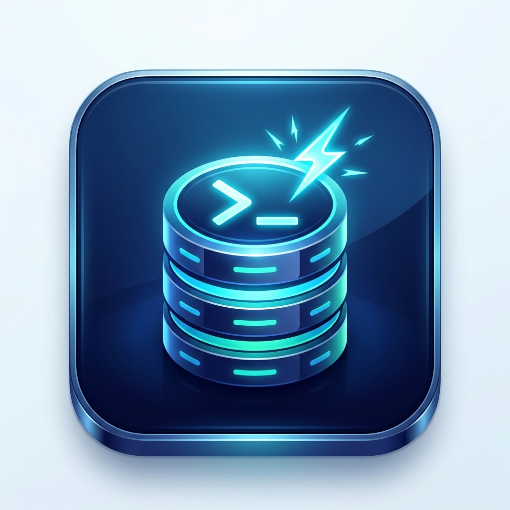

# 📱 SQL Trainer KZ — SQL Оқыту Мобильді Қосымшасы

<p align="center">
  
</p>

<p align="center">
  <b>SQL сұраныстарын қазақ және орыс тілдерінде интерактивті түрде үйренуге және жаттығуға арналған Flutter мобильді қосымшасы.</b>
</p>

---

## 🌟 Жобаның негізгі мүмкіндіктері

- 🎓 **Интерактивті оқу модулі**: Негізгі SQL концепциялары (SELECT, WHERE, JOIN, GROUP BY, т.б.) бойынша теориялық дәрістер.
- 💻 **SQL Консоль / Сұраныс тренажері**: Жергілікті SQLite дерекқорында тікелей сұраныстар орындау және нақты уақытта нәтижесін кесте түрінде көру.
- 🧩 **Көпдеңгейлі тапсырмалар**: Жеңілден күрделіге дейінгі практикалық тапсырмалар жүйесі, көмекші кеңестер (Hints) және дұрыс жауапты тексеру механизмі.
- 🏆 **Геймификация және Прогресс**: XP жинау, деңгейлер (Бастаушы, Орташа, Сарапшы), күнделікті сериялар (Streak) және статистика.
- 🌐 **Екі тілді қолдау**: Қазақша және орысша интерфейс пен тапсырмалар.
- 🌓 **Тақырып таңдау**: Күндізгі (Light) және түнгі (Dark) дизайн режимдері.
- 👤 **Авторизация жүйесі**: Тіркелу, кіру, құпиясөзді қауіпсіз сақтау және профильді басқару.

---

## 🛠 Технологиялық стек

- **Фреймворк**: [Flutter](https://flutter.dev/) (Dart)
- **Дерекқор**: [sqflite](https://pub.dev/packages/sqflite) (SQLite жергілікті дерекқоры)
- **Мемлекетті басқару (State Management)**: [provider](https://pub.dev/packages/provider)
- **Жергілікті сақтау**: [shared_preferences](https://pub.dev/packages/shared_preferences)
- **Шрифттер және Иконкалар**: Google Fonts & Cupertino / Material Icons

---

## 🚀 Жобаны іске қосу (Local Setup)

### 1. Талаптар
- Flutter SDK (3.27+)
- Dart SDK
- Android Studio / Xcode / VS Code

### 2. Орнату және іске қосу

```bash
# 1. Тәуелділіктерді жүктеу
flutter pub get

# 2. Қателерді тексеру
flutter analyze

# 3. Қосымшаны құрылғыда немесе эмуляцияда іске қосу
flutter run
```

---

## 📂 Жоба құрылымы

```text
lib/
├── config/          # Тақырыптар (themes), тұрақты мәндер (constants)
├── l10n/            # Қазақ және орыс тіліндегі локализация файлдары
├── models/          # Деректер модельдері (User, Task, Theory, etc.)
├── providers/       # State Management (AuthProvider, ProgressProvider, ThemeProvider)
├── screens/         # Экрандар (Splash, Auth, Home, Tasks, Theory, Profile)
├── services/        # SQLite Дерекқор қызметі (DatabaseHelper)
└── main.dart        # Қосымшаның кіру нүктесі
```

---

## 👨‍💻 Автор
Astana IT University College курстық жобасы аясында әзірленген.
